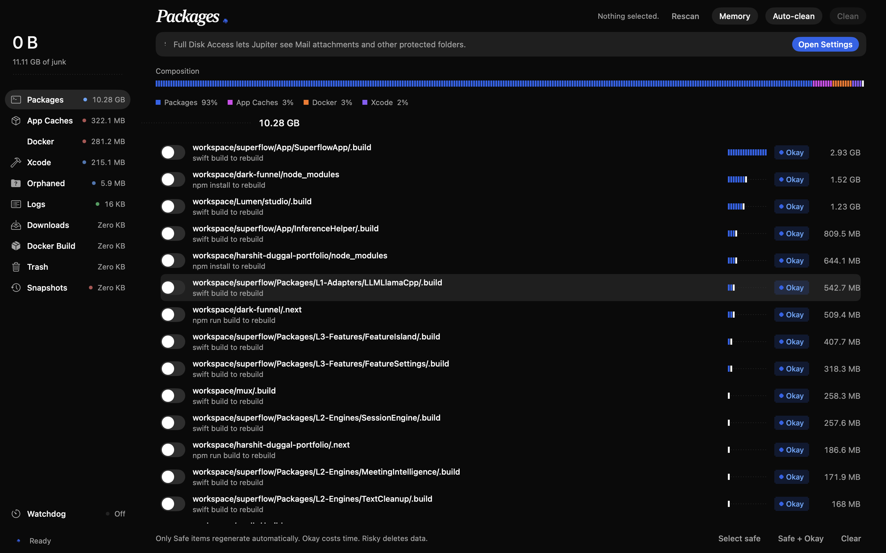
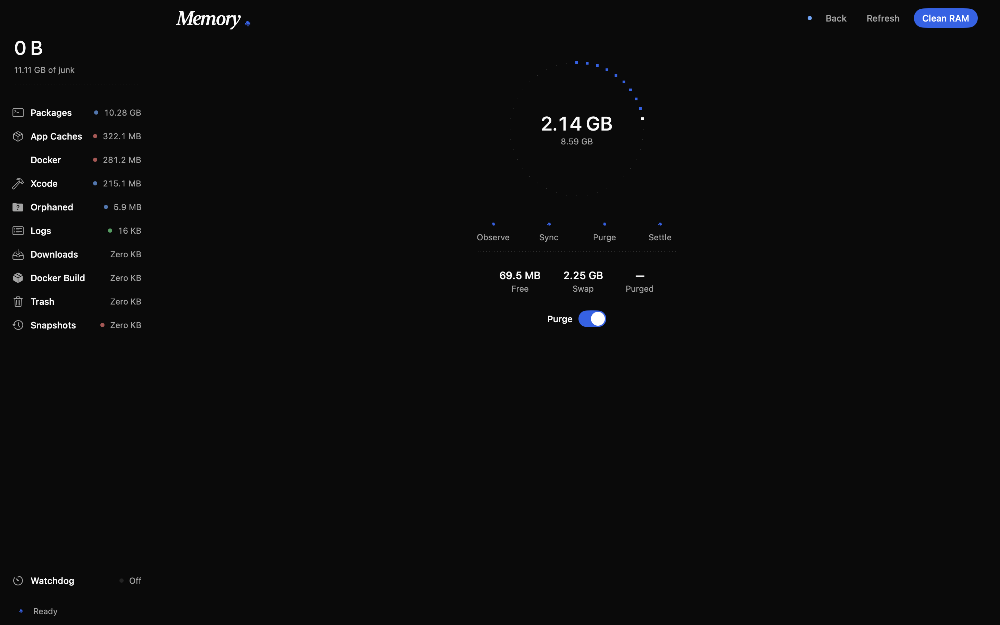

<div align="center">


# Jupiter

**Mac Storage is lying to you. Jupiter shows the truth.**

You're not out of space. The junk macOS hides is. Jupiter finds it, measures it in real allocated bytes, and removes it with one click — no ads, no upsells, no lag.

</div>

## Preview

<p align="center">
  
  
</p>

## Features

- **Tiny:** ~1.3 MB native binary. No Electron. No Chrome inside. Uses almost no RAM.
- **Fast:** Concurrent scan across 9 categories. The UI never blocks. Cleaning streams live, MB by MB.
- **Beautiful:** Dark, pixel-sharp, 60fps hover and click motion. Reduced-motion respected.

## What it finds

Caches, logs, Xcode junk, package stores — plus the real dev culprits nobody mentions: `.node_modules`, `.build`, `target/`, `dist/`, Electron & Tauri builds. Often **30–40 GB** hiding in projects. Every item is badged honestly:

- **Safe** — regenerates automatically. Loses nothing. Auto-Clean takes these, always.
- **Okay** — with limits. Dev builds live here. They rebuild, but it costs a `npm install` or `swift build`. Auto-Clean takes these too.
- **Risky** — deletes user data. Browser caches that wipe your whole Chrome profile (history, logins, session). Downloads, Mail, Docker, snapshots. Never auto-selected. You opt in, item by item.

One tap **Auto-clean** grabs Safe + Okay and flushes RAM without quitting your apps. Nothing risky is ever touched automatically.

## Why I built it

Every cleaner I tried was bloated, laggy, stuffed with ads, and paid. I wanted something clean, sharp, and free forever. So I built it.

## How it works

Native SwiftUI. `_ = FileManager.trashItem` moves files to Trash, never `rm -rf` — everything stays recoverable. Sizes are `st_blocks × 512`, not Finder’s rounded numbers. Scanning and cleaning run on background executors. The UI only animates transform and opacity. Zero third-party dependencies.

## Build & run

```sh
xcodebuild -project Purge.xcodeproj -scheme Purge -configuration Release build
open ~/Library/Developer/Xcode/DerivedData/Purge-*/Build/Products/Release/Jupiter.app
```

Or grab a DMG from **Releases** (Apple Silicon, ad-hoc signed, free forever — first open: Right-Click → Open).

[Download for macOS](landing/index.html) · [Releases](https://github.com/duggal1/Jupiter/releases)
